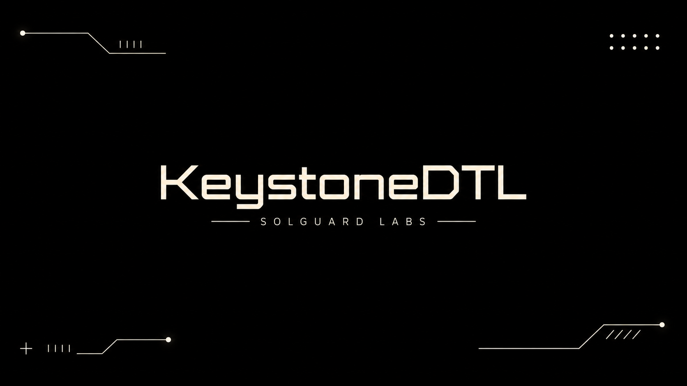

# Keystone DTL



Keystone DTL es una libreria C para custodiar garantias de rutas DTL con
politicas de capacidad por operador, activo y ventana temporal. El nucleo modela
posiciones de garantia, limites operativos, deuda pendiente, diarios de eventos y
flujos de liquidacion deterministas para integraciones de routing financiero.

La libreria esta disenada para revisarse como un componente de protocolo
compacto: no requiere servicios externos, usa aritmetica entera comprobada y
expone una API estable desde `include/keystone_dtl.h`. La suite JavaScript
ejecuta escenarios contra una CLI minima que enlaza la libreria C.

## Componentes

- `include/keystone_dtl.h`: API publica de la libreria.
- `src/kdtl_accounts.c`: cuentas, balances liquidos y depositos.
- `src/kdtl_limits.c`: politicas por operador, activo y ventana.
- `src/kdtl_positions.c`: apertura, reventaneo, cancelacion y expiracion.
- `src/kdtl_settlement.c`: liquidacion y reconciliacion de posiciones.
- `src/kdtl_codec.c`: serializacion JSON de vistas de auditoria.
- `tools/kdtl_scenario.c`: ejecutable de escenarios usado por los tests.
- `tests/node/`: tests de contrato e integracion con `node:test`.
- `docs/INTEGRATION.md`: guia operativa para servicios integradores.

## Requisitos

- Node.js 20 o superior.
- Un compilador C11 disponible como `cc`, `gcc` o `clang`.
- Bash para ejecutar `scripts/ci.sh` y `scripts/tests.sh` en entornos Unix.

En Windows se recomienda usar MSYS2, Git Bash con MinGW, WSL, o definir `CC`
apuntando a un compilador compatible.

## Uso

Compilar el binario de escenarios:

```bash
node scripts/build-native.mjs
```

Ejecutar un escenario:

```bash
./build/kdtl_scenario open-basic
./build/kdtl_scenario liquidation
./build/kdtl_scenario window-rollover
./build/kdtl_scenario operator-overview
```

Ejecutar la suite publica:

```bash
npm test
```

Validacion completa local:

```bash
npm run ci
```

Tambien puede usarse el script Bash:

```bash
bash scripts/tests.sh
```

## Modelo De Protocolo

Un pagador abre una posicion de garantia para una ruta DTL. La posicion bloquea
un importe de un activo, queda asociada a un operador y se asigna a una ventana
temporal. La politica del operador define el maximo de deuda activa permitido,
el maximo por ventana y restricciones operativas como numero de posiciones y
margen minimo.

Las posiciones pueden terminar por:

- liquidacion, cuando existe una perdida observada dentro de la ruta;
- cancelacion autorizada antes de la ejecucion;
- expiracion cuando la ventana de garantia ya no es reclamable.

Cada transicion registra un evento interno y las vistas publicas permiten
revisar balances, estado de posiciones y exposicion agregada por operador.

## Referencia Rapida De API

El flujo recomendado para integradores es:

1. Crear un motor con `kdtl_engine_create`.
2. Registrar activos mediante `kdtl_register_asset`.
3. Registrar cuentas con `kdtl_register_account`.
4. Configurar politica por operador con `kdtl_set_operator_policy`.
5. Depositar liquidez del pagador con `kdtl_deposit`.
6. Abrir garantias con `kdtl_open_position`.
7. Consultar riesgo con `kdtl_get_operator_risk`.
8. Cerrar posiciones por liquidacion, cancelacion o expiracion.
9. Reconciliar el activo con `kdtl_reconcile_asset`.
10. Liberar memoria con `kdtl_engine_destroy`.

Las estructuras publicas usan buffers de longitud fija para que la libreria
pueda enlazarse desde entornos sin asignadores compartidos entre runtimes. Los
identificadores deben caber en los limites definidos por `KDTL_*_LEN` y las
cantidades se expresan como enteros `uint64_t` en unidades menores del activo.

Ejemplo minimo de integracion:

```c
kdtl_engine *engine = kdtl_engine_create();
kdtl_asset_config asset = {0};
kdtl_operator_policy policy = {0};
kdtl_route_terms terms = {0};
kdtl_position_id position_id = 0;

/* Rellenar asset, policy y terms con identificadores propios. */
kdtl_register_asset(engine, &asset);
kdtl_register_account(engine, terms.payer);
kdtl_register_account(engine, terms.beneficiary);
kdtl_register_account(engine, terms.operator_id);
kdtl_set_operator_policy(engine, &policy);
kdtl_deposit(engine, terms.payer, terms.asset, 1000000);
kdtl_open_position(engine, &terms, &position_id);
kdtl_engine_destroy(engine);
```

Para exponer datos a herramientas externas se pueden serializar vistas con:

- `kdtl_format_position_json`;
- `kdtl_format_risk_json`;
- `kdtl_format_account_json`;
- `kdtl_format_reconciliation_json`;
- `kdtl_format_event_json`.

## CI

GitHub Actions instala Node y un toolchain C, ejecuta formato C cuando
`clang-format` esta disponible, compila la libreria y lanza los tests
JavaScript. Dependabot cubre dependencias npm y GitHub Actions.

## Estado

Proyecto de laboratorio para auditoria de logica economica. La documentacion
publica describe el comportamiento esperado de la libreria y los tests cubren
flujos ordinarios de integracion.
