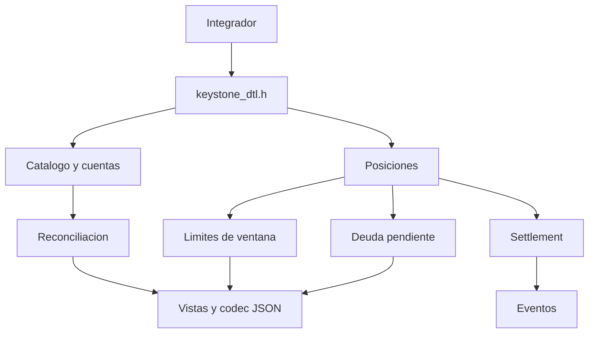
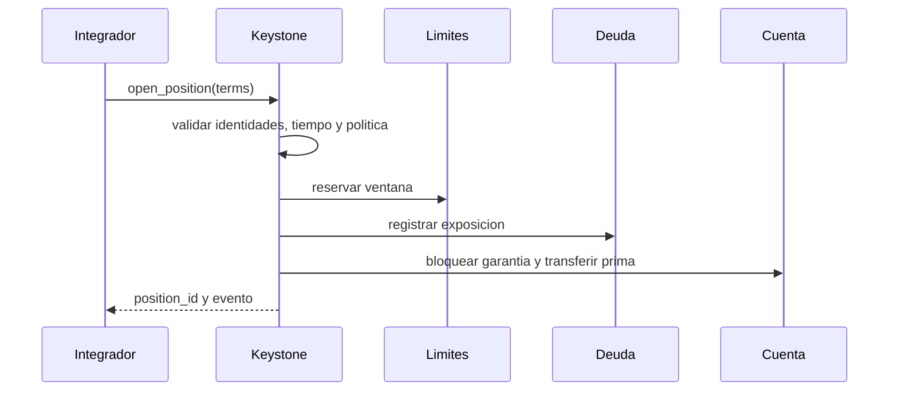

# Arquitectura

## Responsabilidades

Keystone DTL es una libreria embebible: no abre sockets, no administra claves y
no decide por si sola que operador puede originar rutas. Recibe terminos ya
autenticados, aplica politica economica y produce transiciones deterministas.

## Memoria Y Capacidad

El motor usa tablas de capacidad fija. Esta decision evita asignaciones durante
una transicion y hace predecible el coste de memoria. Alcanzar un limite devuelve
`KDTL_ERR_CAPACITY`; nunca autoriza una escritura parcial.

| Tabla      |      Capacidad | Identidad                  |
| ---------- | -------------: | -------------------------- |
| Cuentas    |             64 | `account`                  |
| Activos    |             16 | `asset`                    |
| Politicas  |             48 | `operator_id + asset`      |
| Posiciones |            256 | `position_id`              |
| Buckets    | 512 por indice | operador, activo y ventana |
| Eventos    |            512 | secuencia monotona         |

## Transaccion De Apertura

Cada paso posterior compensa los anteriores si falla. El registro de posicion y
evento solo se produce al final.

## Fronteras De Confianza

- El integrador autentica al llamante y persiste el motor.
- Los timestamps deben proceder de una fuente monotona del entorno.
- Los identificadores tienen longitud fija y no deben truncarse.
- La CLI de escenarios es una herramienta de contrato, no un servicio remoto.
- Los JSON representan una lectura; la estructura C sigue siendo la fuente
  canonica para la llamada concreta.
