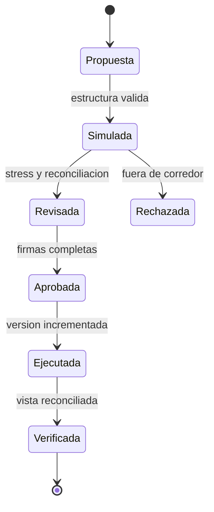

# Gobernanza De Politicas

## Clasificacion

`kdtl_review_operator_policy` compara politica actual, propuesta y corredor
aprobado. El resultado no aplica el cambio; determina la revision minima.

| Nivel      | Ejemplos                                    |
| ---------- | ------------------------------------------- |
| Rutinaria  | cambio sin aumento de exposicion            |
| Tesoreria  | mayores techos o mas posiciones             |
| Riesgo     | menor margen o mayor gracia temporal        |
| Gobernanza | cambio de identidad o excepcion al corredor |

Cuando coinciden varias reglas prevalece la mas estricta.

## Expediente

- politica actual y propuesta completas;
- flags, nivel y headroom calculados;
- utilizacion y posiciones abiertas;
- escenarios adversos;
- responsable, aprobadores y ventana de ejecucion;
- plan de reversa y señales posteriores.

Una transaccion confirmada no demuestra que el cambio sea economicamente
aceptable. El expediente se cierra al verificar la version, la vista de riesgo,
la reconciliacion y el periodo de observacion.
