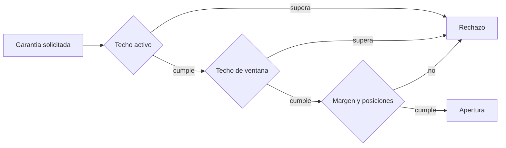

# Modelo Economico

## Posicion De Garantia

Una ruta bloquea `G` unidades del activo del pagador. La prima `P`, si existe,
se transfiere al operador al abrir:

```text
liquid_payer_after = liquid_payer_before - G - P
locked_payer_after = locked_payer_before + G
liquid_operator_after = liquid_operator_before + P
```

Las cantidades son enteros `uint64_t` en la unidad minima del activo. Toda suma,
resta y multiplicacion por puntos basicos comprueba rango.

## Liquidacion

Para una perdida observada `L`, una penalizacion `p` y una garantia pendiente
`G`:

```text
penalty = floor(L × p / 10.000)
claim = min(L + penalty, G)
refund = G - claim
```

El liquidador recibe `claim` y el remanente vuelve al pagador. La posicion queda
terminal y sus indices economicos se liberan una sola vez.

## Capacidad

La admision combina un techo por operador y un techo por ventana:

```text
projected_active = indexed_active + new_guarantee
projected_window = reserved_window + new_guarantee
```

Ambos deben quedar por debajo de la politica. `max_open_positions` limita la
fragmentacion y `min_margin_bps` exige un colchon contractual minimo.



## Conservacion

Por activo, la reconciliacion esperada es:

```text
accounted_total = Σ liquid(account) + Σ locked(account)
```

Primas y liquidaciones trasladan valor entre cuentas, pero no crean unidades.
El snapshot de reconciliacion separa posiciones abiertas y terminales para
facilitar el cierre de lotes.

## Ventanas

Una ventana expresa el intervalo economico de la ruta; `expires_at` define el
ultimo instante de reclamacion. Mover una ventana no cambia garantia, prima,
pagador ni beneficiario. La operacion registra una nueva version temporal y un
evento para que el integrador pueda explicar el cambio.
