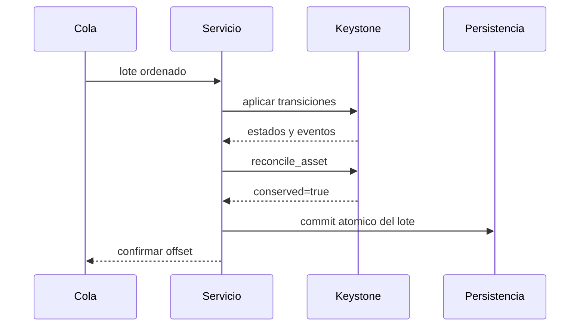

# Operacion

## Inicio

1. Fijar commit, compilador y `package-lock.json`.
2. Ejecutar `npm ci` y `npm run ci`.
3. Crear el motor y registrar activos antes de cuentas y politicas.
4. Restaurar estado persistido o comenzar con exposicion nula.
5. Comparar reconciliacion, secuencia de eventos y politicas cargadas.
6. Habilitar admision solo despues de validar snapshots.

## Observabilidad

| Señal              | Fuente                   | Respuesta                         |
| ------------------ | ------------------------ | --------------------------------- |
| Utilizacion activa | `kdtl_get_operator_risk` | revisar nuevas aperturas          |
| Concentracion      | snapshot de stress       | reducir ruta u operador dominante |
| Conservacion       | `kdtl_reconcile_asset`   | detener lote y reconciliar        |
| Capacidad interna  | codigo de error          | compactar o rotar instancia       |
| Secuencia          | `kdtl_get_event`         | recuperar persistencia faltante   |

## Procesamiento Por Lotes

No confirme el offset antes de persistir motor, eventos y resultado de
reconciliacion. Ante un reinicio, el nonce del pagador y el identificador de ruta
evitan repetir una apertura confirmada.

## Incidentes

- Rechazo de politica: releer politica y riesgo; no reintentar sin cambios.
- Descuadre de reconciliacion: aislar la instancia y conservar snapshot.
- Timestamp no monotono: rechazar el lote y corregir la fuente temporal.
- Capacidad agotada: no ampliar tablas en caliente; migrar con expediente.
- Binario distinto: comparar commit, hash y contrato JSON antes de restaurar.

La reactivacion requiere causa identificada, estado reconciliado, pruebas
correctas y un criterio de seguimiento explicito.
