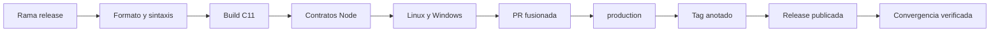

# Proceso De Release

## Gates



Comandos locales:

```bash
npm ci
npm run ci
node scripts/verify-public.mjs
```

La etiqueta estable debe ser anotada. `scripts/verify-release.mjs` confirma que
el checkout, `origin/main`, `origin/production` y la etiqueta resuelven al mismo
commit. La release solo se considera completa cuando su propio evento de
integridad termina correctamente.

## Manifiesto

Registre commit baseline y final, PR, ejecuciones CI, objeto de etiqueta, URL de
release, hash del banner, compiladores y recuento de pruebas. No mezcle una
validacion local con la incorporacion remota: son evidencias distintas.
