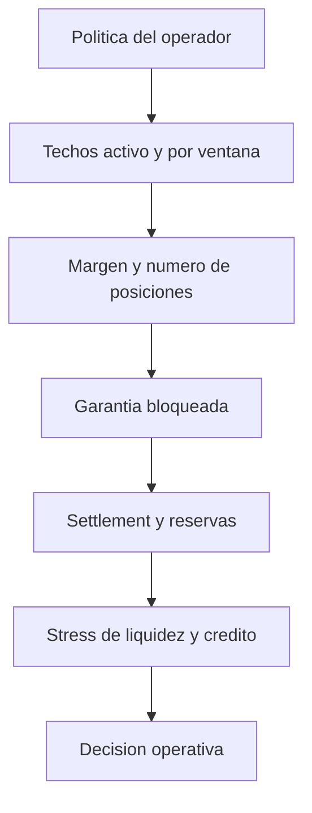

# Riesgo Y Escenarios Adversos

## Capas



`kdtl_evaluate_stress` es puro: recibe una instantanea y un escenario; no lee ni
modifica el motor. Esto permite guardar inputs, repetir calculos y comparar
versiones.

## Calculo De Stress

```text
defaulted = active_guarantee × default_bps
performing = active_guarantee - defaulted
gross_recovery = defaulted × recovery_bps
liquidation_cost = gross_recovery × liquidation_cost_bps
credit_loss = active_guarantee - performing - gross_recovery + liquidation_cost
usable_reserves = reserves × (1 - reserve_haircut_bps)
residual_loss = max(credit_loss - usable_reserves, 0)
```

La cobertura compara activos recuperables y reservas absorbidas con garantia
activa mas settlements pendientes. La concentracion mide la mayor ruta respecto
de la garantia activa.

## Ejemplo

| Entrada              |     Valor |
| -------------------- | --------: |
| Liquidez financiada  | 1.000.000 |
| Garantia activa      |   600.000 |
| Settlement pendiente |   100.000 |
| Reservas             |    80.000 |
| Default              |      25 % |
| Recuperacion         |      40 % |
| Coste de liquidacion |      10 % |
| Recorte de reservas  |      25 % |

El resultado produce 96.000 de perdida crediticia, 60.000 de absorcion y
36.000 residuales. La cobertura alcanza 8.057 bps y la concentracion 4.000 bps.

## Corredores

Un resultado no ejecuta una pausa automaticamente. Debe existir un procedimiento
que relacione cobertura, concentracion y buffer con reduccion de limites,
restriccion de nuevas rutas o revision de tesoreria.

Escenarios recomendados: estable, adverso y severo. Cada uno debe registrar
fecha, procedencia del snapshot, parametros, version de libreria y aprobador.
